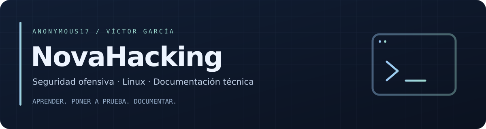

  

  

  <strong>Pentester junior · Estudiante de Ciberseguridad · Panamá 🇵🇦</strong> 
  Anonymous17 — Seguridad ofensiva, Linux y conocimiento compartido.

  <a href="https://www.linkedin.com/in/victor-garc%C3%ADa-nova-hacking/">💼 LinkedIn</a>
  &nbsp;·&nbsp;
  <a href="mailto:victordgarciap2003@gmail.com">✉️ Contacto</a>

---

## 👨‍💻 Sobre mí

Estudio la **Licenciatura en Ciberseguridad** y practico pentesting en laboratorios y desafíos **CTF**. Me interesa entender cómo funcionan las vulnerabilidades, interpretar los resultados y explicar el razonamiento detrás de cada técnica.

Disfruto la **seguridad ofensiva, la ingeniería inversa y la programación**. Trabajo con **Arch Linux, Kitty y Neovim**, y documento lo que aprendo para compartirlo con la comunidad.

## 🚀 Mis proyectos y publicaciones

| Proyecto | Qué encontrarás |
| :--- | :--- |
| **📚 [NovaHacking](https://novahacking.gitbook.io/anonymous17)** | Mi proyecto principal de documentación en español: **writeups de CTFs, herramientas de pentesting, Linux y artículos técnicos** sobre buffer overflow, pivoting, hashes, RSA y Suricata. Aquí publico el contenido nuevo, con comandos, evidencias y explicaciones. |
| **🐳 [Anonymous17 en DockerLabs](https://dockerlabs.es/perfil/anonymous17)** | Mi actividad en la plataforma: **máquinas resueltas, writeups publicados y progreso en los laboratorios**. Un punto de encuentro entre la práctica y la documentación. |
| **⌨️ [My_Nvim](https://github.com/anonymous-17-03/My_Nvim)** | Mi configuración de **Neovim en Lua**, con TokyoNight, menú NovaHacking, autocompletado, LSP, Git y depuración. Incluye instrucciones y capturas para probarla o adaptarla. |
| **🌐 [Portfolio personal](https://anonymous-17-03.github.io/)** | Mi presentación, formación, proyectos, acceso al **currículum** y archivo de mis primeros writeups. Las publicaciones antiguas se conservan mientras la documentación nueva crece en GitBook. |

## 🛠️ Herramientas y tecnologías

  

| Área | Herramientas que uso en mis prácticas |
| :--- | :--- |
| **Reconocimiento y seguridad web** | Nmap · ffuf · Feroxbuster · Gobuster · Caido |
| **Reversing y depuración** | GDB · Ghidra · radare2 |
| **Contraseñas y hashes** | Hashcat · Hydra |
| **Programación y entorno** | Python · Bash · Lua · Docker · Git · Neovim |

Me interesa colaborar en proyectos de aprendizaje, intercambiar ideas y recibir sugerencias que ayuden a mejorar lo que comparto.

## 📊 Mi actividad en GitHub

  
  

  

  <a href="https://github.com/search?q=author%3Aanonymous-17-03+is%3Apr&amp;type=pullrequests">Ver mis pull requests ↗</a> 
  Tarjetas generadas por servicios externos; pueden tardar en actualizarse. Los lenguajes reflejan el código analizado, no el nivel de dominio.

---

  <strong>Aprender, poner a prueba y documentar.</strong> 
  Prácticas de seguridad en CTFs, laboratorios y entornos autorizados. 

